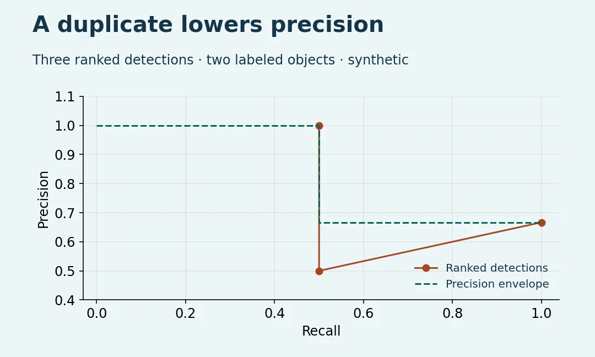
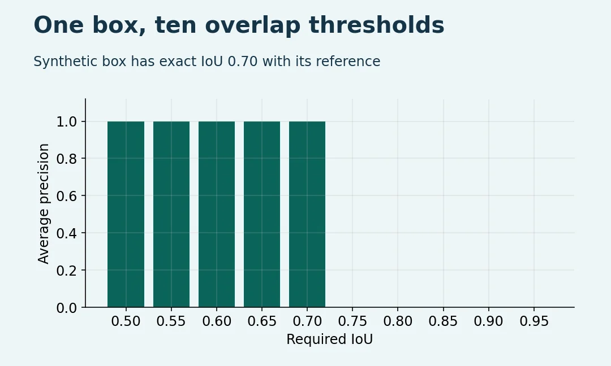

# YOLO mAP Calculation: A Small Python Lab

Inspect the ranked decisions behind bounding box average precision. The examples are synthetic; no YOLO model, weights or GPU is used.

Full illustrated lesson: https://wifarobotics.com/learn/yolo-map-calculation/

Install Python 3.11 or newer from https://www.python.org/downloads/. Download the repository using **Code → Download ZIP**, extract it and open a terminal there. Run `python3 --version`; on Windows use `py -3` instead of `python3`.

```sh
python3 detection_ap.py examples/duplicate.json
python3 detection_ap.py examples/localization.json
python3 detection_ap.py examples/classes.json
python3 -m unittest discover -s tests -v
```

Expect mAP50, mAP75 and mAP50–95 of about (.835, .835, .835), (1, 0, .5), and (.5, .5, .5), respectively. Each input has a `truth` list and `predictions` list. Both use image and label strings plus integer `[xmin,ymin,xmax,ymax]` pixel coordinates; predictions also need a score in [0,1]. A prediction can match one unused annotation in the same image and class. A tie uses input order. Classes without truth are explicitly listed as excluded.

If your evaluator disagrees, check box format, split, confidence filters, ties, ignore/crowd rules, class definitions, AP interpolation and maximum detections. This is a teaching implementation of a 101-point precision envelope, not Ultralytics or COCO benchmark software. It does not implement area ranges, ignored annotations, crowd matching or detection caps beyond its input size limit. Use the actual benchmark tool for reported model results.




Optional: install Matplotlib and Pillow in a separate environment and run `python3 diagrams/render.py` to rebuild the figures and editable SVGs. The analyzer and tests use only the standard library.
